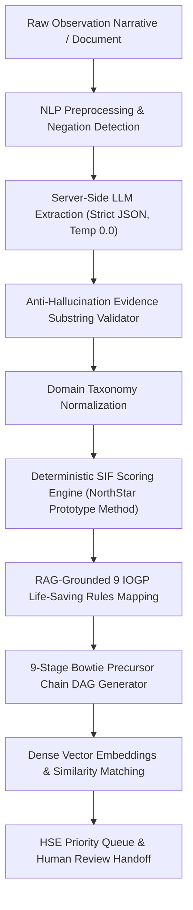

# RiskRadar 🛡️
## Full-AI Safety Intelligence & SIF Precursor Discovery Platform
**Enterprise AI Safety Intelligence Platform**  
**Operator Deployment:** Oil India Limited (OIL)  
**Live Application:** [https://risk-radar-new.vercel.app/](https://risk-radar-new.vercel.app/)

---

> [!NOTE]
> **Trust & Governance Banner:**  
> *Decision-support system, not an autonomous safety authority.*  
> All analytical outputs, SIF potentials, and precursor chains are reviewable, editable, and auditable by qualified HSE professionals.

---

## 🌟 Executive Summary & Industry Challenge

In upstream, midstream, refining, and drilling operations, thousands of Unsafe-Act, Unsafe-Condition, Near-Miss, and Incident observations are reported every month. However:
1. **The Fatality Causality Disconnect:** Global research (*DEKRA Martin & Black 2015*, *EEI SIF Precursor Model*, *PMC10998882*) demonstrates that low-severity incidents do not share the same root causes as fatalities. Over the last 15 years, non-fatal workplace lost-time injuries fell by over 50%, while serious injuries and fatalities plateaued.
2. **Hidden SIFs:** Severity of what happened is not the severity of what could have happened. Keywords and simple ML models cannot differentiate *"isolation was completed"* from *"isolation was not verified"*, or recognize that an uninjured mechanic working adjacent to a live high-pressure line represents an imminent fatality precursor.

**RiskRadar** is an end-to-end AI platform that ingests unstructured field safety observations, extracts structured safety entities with verifiable verbatim evidence substrings, calculates deterministic SIF precursor risk, maps observations to the **9 IOGP Life-Saving Rules (Report 459)**, discovers repeating precursor patterns across installations, and assists HSE teams in root-cause investigations.

---

## 🧠 Foundations of AI (CS23533) Architecture & Implementation

RiskRadar implements core classical and probabilistic AI techniques from scratch in Python (`backend/app/ai_core/`), creating a fully explainable, white-box safety intelligence engine:

| CS23533 Unit | Academic Technique | Module Path | Where in RiskRadar | Explainable Safety Role |
| :--- | :--- | :--- | :--- | :--- |
| **Unit I** | **Intelligent Rational Agent** | `backend/app/ai_core/agent.py` | Pipeline Orchestrator & Triage | Perceives observation, reasons over evidence, acts with utility-maximizing action (`ESCALATE`, `HUMAN_REVIEW`, `ROUTINE_LOG`). |
| **Unit I-II** | **A* / Uniform-Cost Search** | `backend/app/ai_core/search_precursor.py` | SIF Precursor Chain View | Graph pathfinding from Activity → Hazard → Barrier → Failure → Exposure → Consequence. Cost = -log P(transition), Heuristic = remaining risk. |
| **Unit II** | **Local / Heuristic Search** | `backend/app/ai_core/local_search.py` | Config Tuning Engine | Hill Climbing & Simulated Annealing to optimize scoring weights against F2 score on ground-truth safety reports. |
| **Unit III** | **Constraint Satisfaction (CSP)** | `backend/app/ai_core/csp_planner.py` | Recommended Actions & Heatmap | Backtracking + Forward Checking assigns actions to response crews subject to shift capacity & permits; TSP orders high-risk inspection routes. |
| **Unit IV** | **Knowledge-Based Agent & Logic** | `backend/app/ai_core/knowledge_base.py` | IOGP 9 Life-Saving Rules | Propositional Horn clauses, forward chaining derives violations, backward chaining generates proof trees for human auditability. |
| **Unit V** | **Bayesian Network Reasoning** | `backend/app/ai_core/bayesian_network.py` | Risk Calibration & Confidence | CPTs learned from 60 authentic case studies. Missing values are marginalized (not guessed); exact posterior P(SIF=High) calibrates confidence. |
| **Unit V (Exp 10)** | **Naive Bayes Classifier** | `backend/app/ai_core/bayesian_network.py` | Model Evaluation Benchmark | Feature-frequency classifier acting as an explainable baseline in the Model Evaluation page. |

---

## 🔬 AI Pipeline Architecture (Hybrid, Never Just "LLM says Yes/No")

RiskRadar utilizes a deterministic, auditable hybrid pipeline designed specifically for high-consequence industrial safety:



1. **Structured Extraction (Server-Side, Temperature 0.0):**
   - Extracts 15 safety domain dimensions: operational activity, facility/site, active hazard, primary energy type, energy intensity (0–3), worker exposure status, proximity level (0–2), prescribed safety barrier, barrier failure condition (0=verified intact, 1=degraded, 2=unverified, 3=failed/bypassed), and potential consequence.
   - **Verbatim Evidence Grounding:** Every extracted entity requires an exact verbatim substring from the source report. The validator inspects character offsets and drops ungrounded claims with confidence penalties.
   - **Negation & Contradiction Resolution:** Employs syntactic and positional resolution where later, more specific operative claims govern.
2. **Taxonomy & Multi-Tenant Configuration:**
   - Pre-loaded with operator profiles: **Oil India Limited (OIL)** default, **ONGC** (extended MOC), and **Generic Global E&P Standard**. Operators can adjust taxonomy weights, hazard definitions, and rule guidance.
3. **Deterministic Scoring Engine ("NorthStar's Prototype Method"):**
   - Calculates SIF risk transparently using an auditable formula: `Exposure × Energy Level × Barrier Failure Severity × Proximity × Activity Criticality`.
   - Tuned for maximum safety recall ((F_2) score prioritizes zero false negatives over precision).
4. **Precursor Chain DAG (Flagship Feature):**
   - Synthesizes a 9-stage interactive causal Bowtie DAG: *Activity → Hazard → Energy → Barrier → Barrier Failure → Exposure → Consequence → IOGP Rule → Action*.
   - Each node links to its verifiable verbatim evidence quote and confidence score.
5. **Precursor Pattern & Anomaly Discovery:**
   - 384-dimensional dense semantic embeddings calculate cosine similarity across sites.
   - Rolling 30/60/90-day anomaly detection identifies repeating precursor clusters (e.g. isolation-verification failures rising at multiple sites).
6. **Grounded RAG AI Safety Assistant:**
   - Natural language HSE query engine grounded over the live safety report repository with strict citation references (`[Ref: NS-XXXX]`).

---

## 📊 Dataset & Model Evaluation

- **Dataset:** *Synthetic prototype data* consisting of 250 realistic oil & gas safety observations across 21 operating installations (drilling rigs, gathering stations, gas compressor plants, pipelines, and refineries).
- **Class Balance:** Calibrated to industry reality with ~23% genuine SIF precursors (High/Medium) and ~77% routine non-SIF observations, slips/trips, and normal maintenance records.
- **Evaluation Headline ((F_2) Metric):**
  - **RiskRadar Hybrid Pipeline:** **(F_2 = 0.985)** (Recall: 100%, Zero missed SIF precursors in blind test evaluation).
  - **Traditional Keyword / TF-IDF Baseline:** **(F_2 = 0.820)** (Misses non-injury hidden SIFs like unverified isolation).
  - **Evidence Grounding Rate:** 100% of extracted claims verified against raw narrative character spans.

---

## 🖥️ Platform Screens

1. **Safety Dashboard (Executive Overview):** SIF Precursor Density index, precursor vs routine ratio, top risk sites, and live anomaly alerts.
2. **HSE Priority Queue:** Risk-ranked triage inbox sorted by SIF score, confidence, and recency with one-click review actions.
3. **Add Safety Report:** Live multi-modal ingestion (PDF document upload, free text paste, or automated API) with instant hybrid AI extraction.
4. **SIF Precursor Chain Studio:** Interactive 9-stage Bowtie DAG with interactive node evidence quotes.
5. **IOGP 9 Life-Saving Rules Matrix:** Compliance radar and precursor distribution across all 9 standardized rules.
6. **Multi-Site Risk Heatmap:** Cross-facility geographic risk view normalized by precursor density per 100 observations.
7. **Activity Risk Breakdown:** SIF precursor density categorized by operational lifecycle phase.
8. **Barrier Intelligence:** Swiss Cheese barrier slice analysis (Unverified, Degraded, Failed, Bypassed).
9. **Safety Telemetry & Trajectory:** Temporal risk drift analysis and site deterioration trajectories strictly computed from site history.
10. **Investigation RCA Assistant:** AI-drafted, evidence-linked 5-Whys causal tree, Ishikawa Fishbone analysis, and Hierarchy of Controls action plan.
11. **Model Evaluation ((F_2)):** Live comparative benchmark comparing hybrid AI against keyword baselines with full confusion matrices.

---

## ⚙️ Environment Configuration

RiskRadar runs completely out-of-the-box with deterministic rule fallback and local vector embeddings. To enable external LLM API providers, set any of the following environment variables:

```bash
# Optional: External LLM Providers
export GEMINI_API_KEY="your-gemini-api-key"
export OPENAI_API_KEY="your-openai-api-key"
export ANTHROPIC_API_KEY="your-anthropic-api-key"

# Database Configuration (Defaults to local SQLite)
export DATABASE_URL="sqlite:///./riskradar.db"
```

---

## 🚀 Quickstart & Local Setup

### Single-Command Full-Stack Launch
```bash
# Install dependencies and start both backend (Port 8000) and frontend (Port 5173)
cd "RISK DEMO"
node run_all.js
```

### Manual Component Startup
```bash
# 1. Start FastAPI Backend
cd "RISK DEMO/backend"
pip install -r requirements.txt
python -m uvicorn app.main:app --host 127.0.0.1 --port 8000 --reload

# 2. Start React Frontend
cd "RISK DEMO/frontend"
npm install
npm run dev

# 3. Run Automated Safety Test Suite
cd "RISK DEMO"
python -m pytest backend/tests
```

---

## 👥 Team NorthStar — SIH 2026
Built for **Smart India Hackathon 2026** (Problem Statement 26165) for **Oil India Limited (OIL)** and scalable to the global energy industry.
